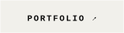
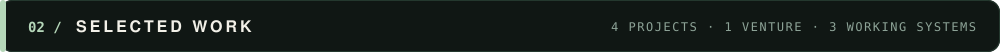
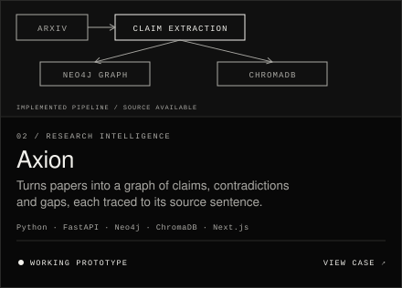
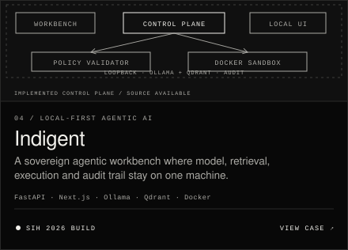
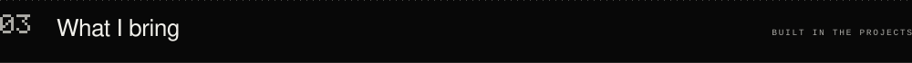
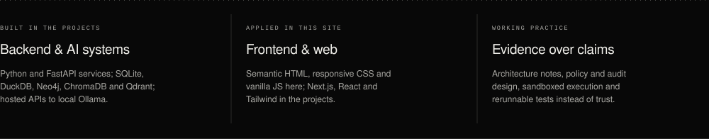
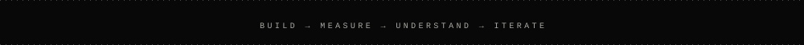

  

  
  
  
  

  KOLKATA, INDIA / IST &nbsp;·&nbsp; DESIGNING ARBITER AT <a href="https://foretyx.in">FORETYX</a> &nbsp;·&nbsp; AI · PRIVACY · HARDWARE

 

**I'm Soham Singh** — co-founder and CEO of [Foretyx](https://foretyx.in), and a second-year B.Tech Information Technology student at Netaji Subhash Engineering College, Kolkata.

I explore AI systems, backend engineering and privacy-focused software through prototypes and the decisions behind them. Most of my work sits where an application hands data to a model — gateways, policy checks, local inference and evidence trails — and I care about what happens at that exact moment.

**Right now**

- Designing **Arbiter**, the policy-aware gateway at Foretyx
- Tightening **Axion**'s evaluation set
- Seeking software, backend and AI engineering internships

+ SMALL, TESTABLE SYSTEMS &nbsp;&nbsp; + EXPLICIT DATA BOUNDARIES &nbsp;&nbsp; + REAL-WORLD CONSTRAINTS

<i>Grim guards the boundary and reaps PII.</i>

 

 

One venture-stage product and three working systems with public source. Each case study separates what runs today from what is still being designed, so the maturity stays honest.

  
  
  
  

  Full architecture, tradeoffs and what is not built yet: <a href="https://sohamsingh.indevs.in/systems"><b>sohamsingh.indevs.in/systems</b></a>

 

A working implementation you can inspect: [the source of this site ↗](https://github.com/Som007-builds/Portfolio-Neumorphism). Axion, Orion and Indigent have public source; Foretyx / Arbiter is a venture-stage design.

 

 

- **Starting with the data boundary** · *Privacy, April 2026* · [read ↗](https://sohamsingh.indevs.in/codex#privacy-first)
- **From proxy to policy** · *Architecture, April 2026* · [read ↗](https://sohamsingh.indevs.in/codex#policy-architecture)
- **Systems before scripts** · *Systems, 2025* · [read ↗](https://sohamsingh.indevs.in/codex#systems-before-scripts)
- **The case for local models** · *Local AI, 2025* · [read ↗](https://sohamsingh.indevs.in/codex#local-models)

 

  

  © 2026 Soham Singh &nbsp;·&nbsp; <a href="https://github.com/Som007-builds">GitHub</a> &nbsp;·&nbsp; <a href="https://www.linkedin.com/in/soham-singh-a21688307/">LinkedIn</a> &nbsp;·&nbsp; <a href="mailto:sohamsingh572@gmail.com">Email</a> &nbsp;·&nbsp; <a href="https://sohamsingh.indevs.in">sohamsingh.indevs.in</a>

  

