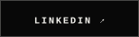
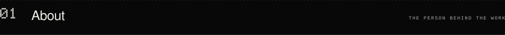
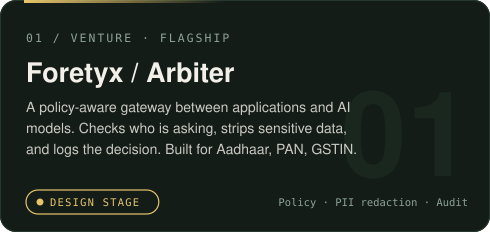
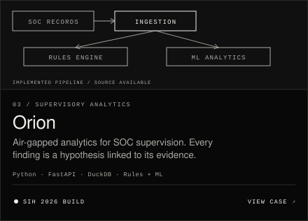
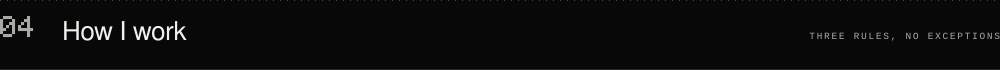
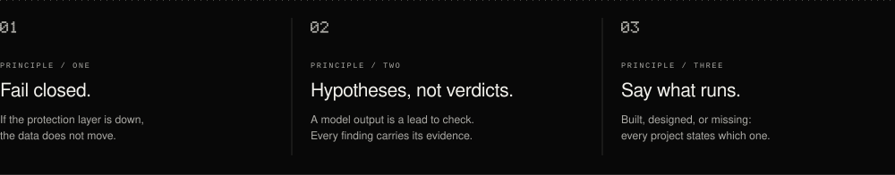

  

  
  
  
  

 

**Co-founder and CEO of [Foretyx](https://foretyx.in).** Second-year B.Tech IT student at Netaji Subhash Engineering College, Kolkata.

I build software that decides what an AI system is allowed to see: gateways, policy checks, local inference, and evidence trails. Most of my work sits where an application hands data to a model, and I care about what happens at that exact moment.

**Right now**

- Shaping **Arbiter**, a gateway for the moment an app sends data to a model
- Tightening **Axion**'s evaluation set
- Looking for internships and research collaborations

*Grim guards the boundary and reaps PII.*

 

 

  
  
  
  

Full architecture, tradeoffs and what is not built yet: <a href="https://sohamsingh.indevs.in/systems.html"><b>sohamsingh.indevs.in/systems</b></a>

 

  

 

- **Starting with the data boundary** · *Privacy, April 2026* · [read ↗](https://sohamsingh.indevs.in/codex.html#privacy-first)
- **From proxy to policy** · *Architecture, April 2026* · [read ↗](https://sohamsingh.indevs.in/codex.html#policy-architecture)
- **The case for local models** · *Local AI, 2025* · [read ↗](https://sohamsingh.indevs.in/codex.html#local-models)

 

  

  

